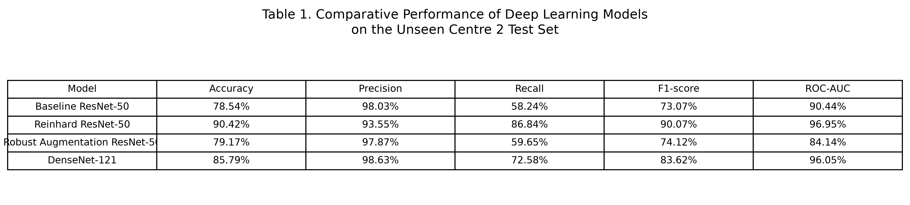
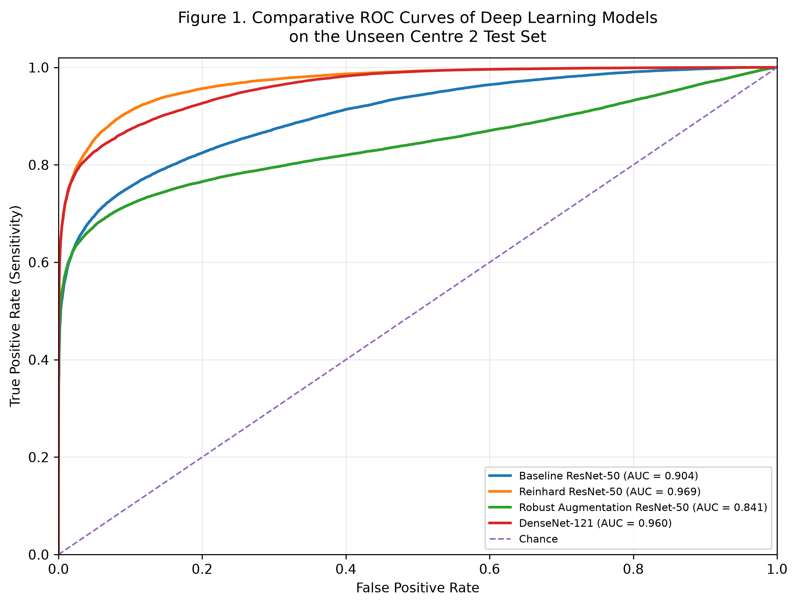
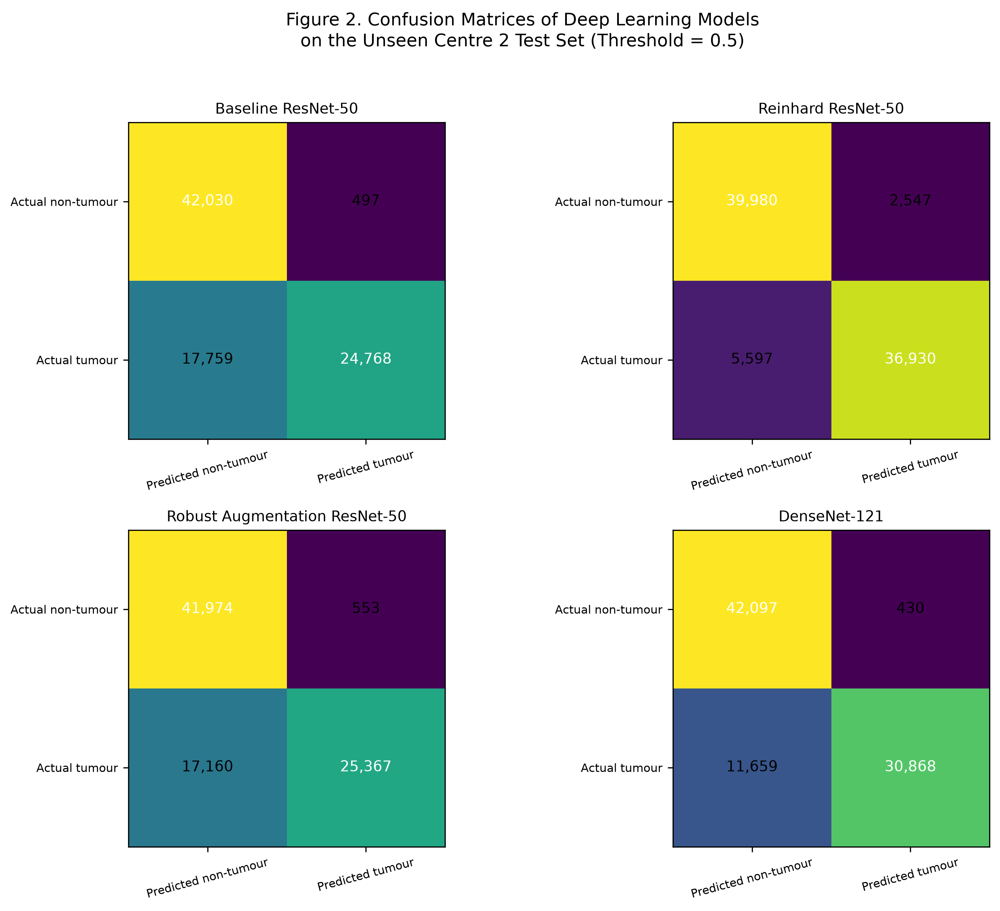
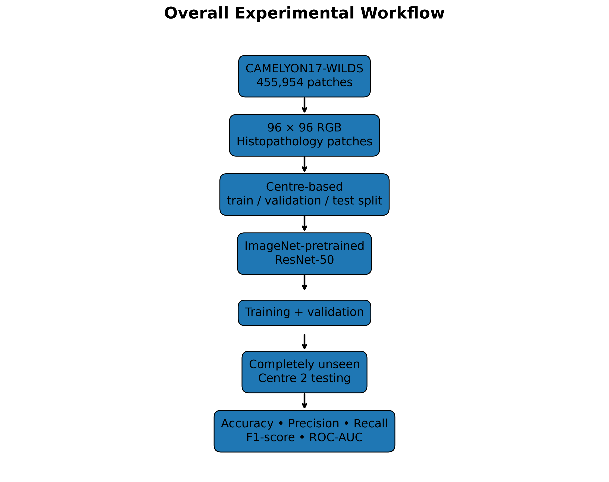
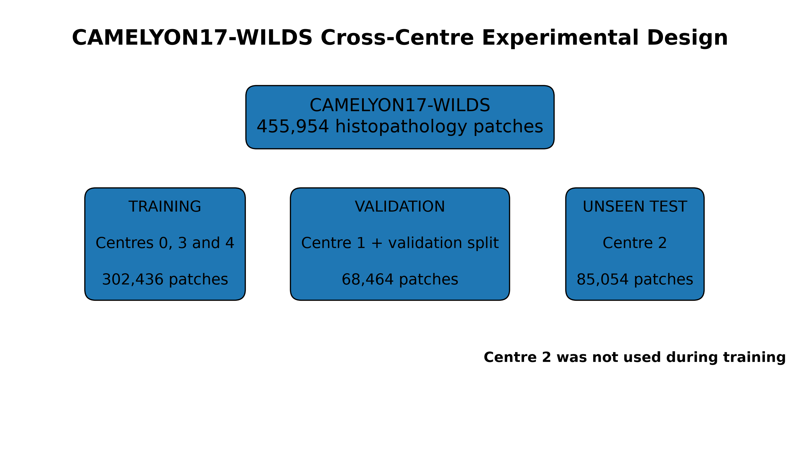
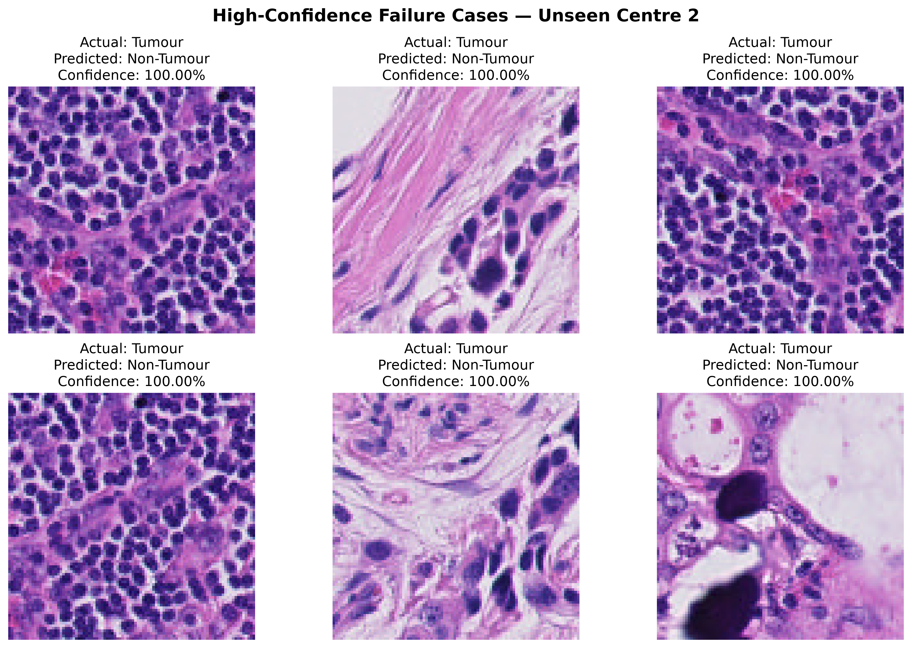

# Robust Deep Learning for Histopathological Cancer Analysis Under Cross-Centre Domain Shift

**Research project | Deep Learning · Computational Pathology · Domain Generalization**

## Overview

Deep learning models trained on histopathology images from one medical centre may perform differently when evaluated on images from another. Differences in tissue staining, scanners, and image acquisition can introduce **cross-centre domain shift**, creating challenges for reliable generalization.

This project investigates cross-centre robustness in binary tumour classification using histopathology patches from the **CAMELYON17-WILDS** dataset. Four model configurations are compared to examine baseline performance, stain normalization, robust augmentation, and model architecture.

The central research question is:

> Can stain normalization and alternative training strategies improve histopathology classification performance on a medical centre that was excluded from training?

## Key Findings

- **Best-performing configuration:** ResNet50 with Reinhard stain normalization.
- **Held-out Centre 2 accuracy:** 90.42%.
- **Held-out Centre 2 F1-score:** 90.07%.
- **Held-out Centre 2 ROC-AUC:** 96.95%.
- The stain-normalized model achieved the strongest overall results among the four evaluated configurations in this experiment.

These are experimental patch-level results, not evidence of patient-level clinical effectiveness.

## Research Objectives

1. Establish a ResNet50 baseline for histopathology patch classification.
2. Evaluate Reinhard stain normalization as a strategy for handling stain variation.
3. Investigate robust data augmentation.
4. Compare ResNet50 and DenseNet121 under the same held-out-centre evaluation setting.
5. Analyze model performance and errors on an unseen centre.

## Methodology

### Dataset

The experiments use CAMELYON17-WILDS, a histopathology dataset containing image patches associated with tumour and non-tumour tissue.

- **Task:** Binary patch classification.
- **Patch dimensions:** 96 × 96 pixels.
- **Number of patches in the Centre 2 evaluation:** 85,054.
- **Dataset availability:** The dataset is not included in this repository.

### Centre-Based Evaluation Strategy

Centre 2 is held out as the unseen test centre.

- **Training:** Designated training split from centres 0, 3, and 4.
- **Validation:** Centre 1 together with the designated validation split from centres 0, 3, and 4.
- **Testing:** All patches from centre 2.

This setup evaluates performance on patches from a centre excluded from model training. It is intended to study cross-centre generalization rather than ordinary random patch-level splitting.

### Models Evaluated

| Experiment | Configuration | Purpose |
|---|---|---|
| 1 | ResNet50 baseline | Establish reference performance |
| 2 | ResNet50 + Reinhard stain normalization | Investigate stain normalization |
| 3 | ResNet50 + robust augmentation | Investigate augmentation-based robustness |
| 4 | DenseNet121 | Compare an alternative CNN architecture |

## Results

### Quantitative Comparison

| Model | Accuracy | Precision | Recall | F1-score | ROC-AUC |
|---|---:|---:|---:|---:|---:|
| ResNet50 baseline | 78.54% | 98.03% | 58.24% | 73.07% | 90.44% |
| ResNet50 + Reinhard normalization | **90.42%** | 93.55% | **86.84%** | **90.07%** | **96.95%** |
| ResNet50 + robust augmentation | 79.17% | 97.87% | 59.65% | 74.12% | 84.14% |
| DenseNet121 | 85.79% | 98.63% | 72.58% | 83.62% | 96.05% |

*All reported metrics are from the held-out Centre 2 patch-level evaluation.*

### Interpretation

ResNet50 with Reinhard stain normalization achieved the highest accuracy, recall, F1-score, and ROC-AUC among the four experiments. Its recall was 86.84%, compared with 58.24% for the baseline ResNet50.

The DenseNet121 model achieved the highest precision at 98.63%, but its overall accuracy and F1-score were lower than those of the stain-normalized ResNet50.

These comparisons suggest that stain normalization may be a useful approach for this experimental setup. Further controlled experiments are needed to establish why performance differs and whether the improvement generalizes to additional centres and datasets.

## Visual Results

### Model Performance Comparison



### ROC Curves

ROC curves compare the models' ability to distinguish tumour from non-tumour patches across classification thresholds.



### Confusion Matrices

Confusion matrices show the distribution of correct and incorrect patch classifications at the evaluated decision thresholds.



## Experimental Workflow



## Centre-Based Dataset Split



## Error Analysis

The following figure presents selected Centre 2 failure cases for qualitative inspection.



## Repository Structure

```text
histopathology_project/
├── docs/
│   └── figures/              # Figures displayed in this README
├── src/                      # Dataset, training, evaluation and plotting scripts
├── results/                  # Experimental outputs (selected files only)
├── data/                     # Local dataset; excluded from Git
├── notebooks/                # Notebook workspace, if populated
├── .gitignore
└── README.md
```

The public repository should contain source code and selected documentation figures, not the dataset, model checkpoints, or large patch-level prediction exports.

## Technologies

- Python
- PyTorch
- Torchvision
- NumPy and Pandas
- Scikit-learn
- Matplotlib

## Reproducibility

The experiment uses a centre-based evaluation design to separate the held-out test centre from the centres used for training and validation.

For reproducible results, the software environment, data preparation, stain-normalization procedure, model configuration, and evaluation thresholds should be documented alongside the code.

Setup and execution commands should be followed once the dependency list and script entry points have been verified against the repository.

## Limitations

- The reported results are patch-level metrics, not patient-level diagnostic performance.
- Results depend on the dataset, split design, model configurations, and evaluation procedure used in these experiments.
- Performance on one held-out centre does not establish generalization to every hospital or scanner.
- Further work is needed to assess calibration, failure modes, external validity, and patient-level aggregation.
- This research implementation is not a clinically validated diagnostic system and must not be used to make medical decisions.

## Future Work

- Evaluate additional domain-generalization and stain-normalization methods.
- Investigate failure cases, confidence calibration, and decision thresholds.
- Improve automated testing and reproducibility.
- Validate findings on additional external centres and datasets.
- Investigate patient-level evaluation where suitable labels and study designs are available.

## Dataset Reference

CAMELYON17-WILDS is part of the WILDS benchmark for distribution shifts in real-world datasets.

- Dataset and benchmark information: https://wilds.stanford.edu/

Please consult the dataset documentation for access requirements, citation guidance, and terms of use.
